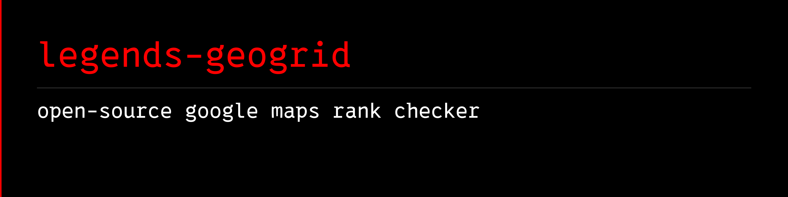

<a name="banner"></a>
<a name="legends-geogrid"></a>

# 

[](https://github.com/avalonreset/legends-geogrid/releases/latest)
[](https://github.com/avalonreset/legends-geogrid/actions/workflows/ci.yml)
[](LICENSE)

legends-geogrid is an **open-source google maps rank checker** for local SEO. See where a business ranks across a geographic grid, compare visibility across services, and turn the evidence into readable PDF reports. Run it locally with your own DataForSEO account, without a rank-tracking subscription.

Explore a complete real-world **10-mile, 0.5-mile spacing (`1,249`-origin, 4-query, top-30)** starter case study for **Home Slice Pizza** in the browser (complete with attached **Campaign Research** and **Keyword Stuffing** business-name reviews), or open the pre-built 18-page Strategy Report in [`examples/starter-home-slice/report/report.pdf`](examples/starter-home-slice/report/report.pdf) without credentials or API spend. Fresh scans use [legends-dataforseo](https://github.com/avalonreset/legends-dataforseo), with explicit execution, cost estimates, and reusable cached results.

The [competitive map companion](docs/COMPANION.md) opens saved battlefield
studies beside your agent conversation. Switch queries and businesses, inspect
rankings at a location, and copy the evidence back into the conversation. The
original studio remains available at `/legacy.html`.

## Agent setup (via `cto-legends`)

Part of the [CTO Legends](https://github.com/avalonreset/cto-legends) ecosystem. `cto-legends` is the only registered skill; this repo vendors a pinned copy at `skills/cto-legends/SKILL.md`.

Install with `cto-legends install legends-geogrid`, then follow the module recipe the router loads. Do not register this module as its own skill.

<p align="left">
  <a href="https://www.youtube.com/shorts/4RYY_gh6b70">
    
  </a>
</p>
<p align="left">
  <a href="https://www.youtube.com/shorts/4RYY_gh6b70"><em>why have we never met before?</em></a>
</p>

## What 0.2.0 adds

A ranking grid should help answer a decision: where does a business appear, which services are weaker, who actually wins each neighborhood, and what should be investigated or changed next? Version 0.2.0 pairs a full-field competitive map companion with circular-lattice sampling, a business-name review workbench, researched study planning, multi-query PDF/HTML reports, a persistent study library, and a complete 10-mile Austin starter case study out of the box.

| Capability | What it gives you |
| --- | --- |
| [Competitive map companion](docs/COMPANION.md) | Interactive circular-lattice explorer for top-30 organic Maps rankings across queries, with equal-sided stop-sign pins, four-corner gradient diamonds, and full-field search across all observed profiles. |
| [Local leaders & neighbor coloring](docs/COMPANION.md) | Recurring (`3+` wins) and all-winner views with neighbor-aware contrasting colors, stable study-wide `L`-number IDs across queries, and outside-circle competitor base connectors. |
| [Strategy room & head-to-head matchups](docs/BATTLEFIELD_INTELLIGENCE.md) | Split-screen regional and service comparison matrix plus direct two-profile head-to-head (`matchup`) map overlays. |
| [Territory campaigns](docs/BATTLEFIELD_INTELLIGENCE.md) | Measured footholds, advance zones (ranks 4-10), defended areas, and study-bound `campaign-research.json` action briefs. |
| [Keyword stuffing & title review](docs/BUSINESS_NAME_REVIEW.md) | Read-only agent-owned dossier for Google Business Profile name discrepancies, combining Standard-queue exact-CID profile refreshes, website branding captures, historical report reconciliation, counterevidence, and an explained `0-5` `title-evidence-v1` concern confidence scale. |
| [Search-window & lattice discipline](docs/SEARCH_WINDOW_POLICY.md) | Unbiased regional sampling (`search_this_area=false`), nested radius composition, and explicit distinction between evidenced top-30 absence and incomplete responses. |
| [10-mile starter case study](examples/starter-home-slice/README.md) | Pre-loaded Home Slice Pizza (`1415 S Congress Ave, Austin, TX`) 10-mile, 0.5-mile spacing (`1,249` origins x `4` queries = `4,996` tasks, `depth=30`) companion study (`src/data/home-slice-study.json`), campaign research (`src/data/home-slice-campaign-research.json`), 165-profile name review (`src/data/home-slice-name-review.json`), and completed 18-page PDF/HTML report (`examples/starter-home-slice/report/`). |
| Research, reports & study library | Website/public-profile evidence, [3-5 justified search themes](docs/QUERY_SELECTION_POLICY.md), Letter PDF/HTML strategy reports, [incremental study enhancement](docs/ENHANCE.md), and hashed Markdown/JSON study banking. |

The software calculates and renders evidence. The operator and agent supply business context, evaluate hypotheses, and write supported recommendations. It does not automatically choose profitable territories, diagnose a Google penalty, or auto-submit Google edits or redressal complaints.

**Business-only request?** Give your agent the [study recipe](docs/STUDY-RECIPE.md). It researches the website, public Google Business Profile and DataForSEO evidence, then recommends [3-5 distinct search themes](docs/QUERY_SELECTION_POLICY.md). A narrower study needs an evidence-backed explanation. The [study command](docs/STUDY_CONTRACT.md) validates that evidence before collection.

**Start here:** [Starter case study](examples/starter-home-slice/README.md) · [Start a study](docs/START_A_STUDY.md) · [Companion guide](docs/COMPANION.md) · [Battlefield intelligence](docs/BATTLEFIELD_INTELLIGENCE.md) · [Business-name review](docs/BUSINESS_NAME_REVIEW.md) · [Search-window policy](docs/SEARCH_WINDOW_POLICY.md) · [Street-map setup](docs/BASEMAPS.md) · [Latest release](https://github.com/avalonreset/legends-geogrid/releases/latest)

## Try a report first

Want to inspect a completed real-world report immediately? Open [`examples/starter-home-slice/report/report.pdf`](examples/starter-home-slice/report/report.pdf) or [`examples/starter-home-slice/report/report.html`](examples/starter-home-slice/report/report.html) (see the [starter case study guide](examples/starter-home-slice/README.md)).

**Want more detail after a study?** Tell your agent **enhance**. It assesses the
saved results, estimates incremental collection, reuses eligible observations,
and produces a new HTML/PDF edition within the approved budget. Original reports
and evidence stay banked. See [enhance a study](docs/ENHANCE.md).

Download and extract the source ZIP, or clone this repository. From its `legends-geogrid` folder, use Python 3.10+:

```sh
python -m pip install -r requirements-report.txt
python tools/strategy_report.py --config examples/reports/urban-dentist.json --output-dir runs/first-report --proof --require-pdf-qa
```

Open `runs/first-report/report.pdf`. This synthetic example makes no network requests and needs no API credentials. Use a fresh output directory when repeating it; existing reports are protected against overwrites. Outputs also include HTML, map images, normalized evidence, and QA results.

**Real reports default to free street maps**, using OpenFreeMap and OpenStreetMap data. No Google API key is required. Install the map renderer once:

```sh
python -m pip install -r requirements-basemaps.txt
python -m playwright install --with-deps chromium
python tools/geogrid_doctor.py --reports --basemaps
```

Internet access is required when acquiring maps. If imagery cannot load, report generation stops with setup guidance instead of silently substituting a bare grid. Synthetic examples remain offline coordinate diagrams. For optional Google Maps imagery, interactive Google Map Tiles API setup, supplied maps, and troubleshooting, see [street-map setup](docs/BASEMAPS.md).

## A local rank tracker at data cost

If you are evaluating a Local Falcon alternative, start with the tradeoff: you own the workflow and local outputs, and take responsibility for setup, scheduling, and interpretation. This is a self-managed tool rather than a managed-service feature match. Fresh searches use your DataForSEO account. The single and bulk runners estimate Standard Queue scans at a modeled base of `$0.0006` per task (`$0.0009` at `depth=30`): a 4-query, 1,249-point 10-mile study (`4,996` tasks) totals about `$3.00` in Standard Queue SERP spend. Adaptive collection uses the Live endpoint and its different rate. These are software estimates, not a live price quotation or a provider-enforced billing cap.

Review the generated estimate and [current provider pricing](https://dataforseo.com/apis/serp-api/google-maps-api) before paid execution. Both an execution flag and a cost ceiling are required. The offline examples and replay mode spend nothing.

## What works

- **Competitive map companion (`src/companion.js`)**: Interactive circular-lattice workspace with five lenses (**Rankings**, **Local leaders**, **Campaigns**, **Keyword stuffing**, and **Head-to-head**), docked/modal **Strategy room**, full observed competitor directory (preserving distinct physical branches by CID), and study-bound sidecar attachments (`*.attachments.json`). The original studio remains available at `/legacy.html`.
- **Business-name review workbench (`tools/business_name_review.py`, `tools/compose_name_reviews.py`)**: Standard-queue exact-CID profile verification, website branding capture, multi-run evidence composition, historical report lead matching, and an explained `0-5` `title-evidence-v1` concern confidence rubric.
- **Circular lattice & radius composition (`tools/lattice_sampling.py`, `tools/radius_sampling.py`, `tools/radius_compose.py`, `tools/competitive_collect.py`)**: Regular lattice planning clipped to a true geographic radius, reusing inner-radius observations when expanding outward under matched controls.
- **Bundled 10-mile Home Slice Pizza starter case study (`src/data/home-slice-*.json`, `examples/starter-home-slice/`)**: Complete 1,249-origin, 4-query top-30 companion dataset, campaign research, 165-profile business-name review, and 18-page PDF/HTML strategy report that load out of the box without API calls.
- **Strategy report engine (`tools/strategy_report.py`)** producing screen-reading Letter PDFs and HTML from normalized multi-lane observations under a strict map-first copy-fit contract.
- **Adaptive sampling collector (`tools/adaptive_geogrid.py`)** supporting sector-based expansion, offline planning, and synthetic replay.
- **Single-business and CSV-driven bulk DataForSEO runners** with estimates, fingerprints, freshness-aware caching, and resumable artifacts.
- **Standard, Priority, and Live DataForSEO methods** with explicit `--execute` and `--confirm-cost-usd` spend gates.
- **Evidence-gate pin verifier (`tools/verify_pins.py`)** tracing every rendered pin to raw JSON.
- **No database, hosted backend, analytics, or telemetry.**

This is a practical local tool and reference implementation, not feature-for-feature parity with a mature hosted platform.

## Quick start and usage: explore the browser demo

Requirements:

- Node.js 20.19+ or 22.12+
- pnpm 10+
- Python 3.10+ for scan runners

```powershell
git clone https://github.com/avalonreset/legends-geogrid.git
cd legends-geogrid
pnpm install --frozen-lockfile
pnpm dev
```

Open the local URL printed by Vite. No DataForSEO credentials are needed for the saved proof or modeled demo.

Run the full local verification after installing the report dependencies:

```powershell
python -m pip install -r requirements-report.txt
pnpm check
```

## Competitive map companion and battlefield workflows

Opening `/` in `pnpm dev` launches the **Competitive map companion** (`index.html`), while `/legacy.html` preserves the original grid studio. The companion provides five coordinated lenses and a split-screen **Strategy room**:

- **Rankings**: Equal-sided stop-sign pins scaled to 30% of grid spacing, four-corner continuous gradient diamonds, animated rank-1 cyan sparkles, and explicit coverage dots distinguishing top-30 absence from incomplete responses.
- **Local leaders**: First-place winners across the grid with deterministic neighbor-aware contrasting colors, stable study-wide `L`-number badges, recurring (`3+` wins) vs. all-winner modes, and dashed connectors to competitor bases more than two miles outside the study circle.
- **Campaigns**: Agent-researched territory campaign options (`campaign-research.json`) paired with spatial footholds, advance zones (ranks 4-10), and defended areas.
- **Keyword stuffing**: Read-only business-name review dossier (`name-review.json`) for recurring Local leaders and matched historical leads, displaying highlighted disputed title words, captured website branding, counterevidence, and an explained `0-5` `title-evidence-v1` concern confidence scale.
- **Head-to-head (`Matchup`) & Strategy room**: Direct two-profile comparison overlays and a resizable split-screen regional/service matrix.

### Circular-lattice collection & radius expansion

Plan a regular circular lattice with `search_this_area=false`, collect or compose nested radii without re-buying inner-radius points, and export a companion study:

```powershell
python tools/competitive_collect.py plan --config runs/my-study/config.json --output-dir runs/my-study/r10
python tools/competitive_export.py --run-dir runs/my-study/r10 --output runs/my-study/r10/companion-study.json
```

See [competitive sampling](docs/COMPETITIVE_SAMPLING.md) and [search-window policy](docs/SEARCH_WINDOW_POLICY.md).

### Business-name review (`Keyword stuffing` workbench)

Plan an offline audit from a saved `companion-study.json` (with optional `--include-cid` or `--only-cid` for targeted refreshes of historical report leads), submit Standard-queue exact-CID profile tasks, capture websites, compose multi-run evidence, and attach the resulting dossier via a study-bound sidecar (`companion-study.attachments.json`):

```powershell
python tools/business_name_review.py plan --study runs/my-study/companion-study.json --output-dir runs/my-study/name-review
python tools/business_name_review.py submit --output-dir runs/my-study/name-review --execute --confirm-cost-usd 0.25
python tools/business_name_review.py retrieve --output-dir runs/my-study/name-review
python tools/business_name_review.py websites --output-dir runs/my-study/name-review
python tools/business_name_review.py export --output-dir runs/my-study/name-review
python tools/business_name_review.py attach --output-dir runs/my-study/name-review
```

See [business-name review](docs/BUSINESS_NAME_REVIEW.md) and [battlefield intelligence](docs/BATTLEFIELD_INTELLIGENCE.md).


## Estimate a fresh scan

Estimation is the default. This command makes no API call and spends nothing:

```powershell
python tools/local_heatmap_poc.py `
  --keyword "pizza" `
  --target-name "Example Pizza" `
  --center-lat 30.249711 `
  --center-lng -97.749132 `
  --grid-size 17 `
  --radius-km 2 `
  --depth 20 `
  --method standard
```

## Install the shared DataForSEO engine

Fresh scans depend on [legends-dataforseo](https://github.com/avalonreset/legends-dataforseo), an open-source Python API client and CLI. It handles provider access without an MCP server. GeoGrid handles the grid, evidence, caching, and reports.

Reports default to the dark theme. For pure-white printable reports, set `"theme": "light"` in the report config; both themes preserve rank colors and legends-geogrid branding.

**Tested pairing:** legends-geogrid v0.2.0 with legends-dataforseo v0.1.0.
The requirement below pins the kit's immutable public source ZIP, so installation
does not require Git. The two projects are maintained and versioned separately.
Offline reports remain usable without the provider dependency or credentials.

```sh
python -m pip install -r requirements-dataforseo.txt
python tools/geogrid_doctor.py --dataforseo
```

The kit is required for fresh scans; saved demos, cost estimates, replay, and offline reports work without it. An agent setting up live scans should install this dependency before execution. See [agent instructions](AGENTS.md).

## Run a paid scan

Set credentials in your shell. Do not put them in Git:

```powershell
$env:DATAFORSEO_LOGIN="your-login"
$env:DATAFORSEO_PASSWORD="your-password"
```

Then repeat the estimate command with both spend gates:

```powershell
python tools/local_heatmap_poc.py `
  --keyword "pizza" `
  --target-name "Example Pizza" `
  --center-lat 30.249711 `
  --center-lng -97.749132 `
  --grid-size 17 `
  --radius-km 2 `
  --depth 20 `
  --method standard `
  --diagnostic --execute `
  --confirm-cost-usd 0.18
```

The command refuses to execute when its estimated base cost exceeds the ceiling.

For reliable business matching, anchor identity with `--target-cid`, `--target-place-id`, or `--target-domain`. Domain matching uses canonical hostname boundaries (ignoring protocol and leading `www.`). When specific identifiers are provided, every supplied identifier must match; the runner never falls back to loose name matching or unmatched domains. Ambiguous name matching is rejected. Use `--zoom 3` through
`--zoom 21` and explicitly choose `--search-this-area` (default true, preserving
the previous provider default) or `--no-search-this-area`. Zoom changes the search
viewport independently of grid spacing. Calibrate a few representative points
before expanding a scan: a short viewport result list is not proof of rank 20+.

## Bulk scans

Start with the bundled no-credit dry run:

```powershell
pnpm dryrun:sample
```

Estimate your own CSV:

```powershell
python tools/bulk_geogrid_runner.py `
  --prospects prospects.csv `
  --run-id dentists-austin `
  --method standard `
  --grid-size 5 `
  --radius-km 2 `
  --depth 20
```

Execute only after reviewing the manifest and total ceiling:

```powershell
python tools/bulk_geogrid_runner.py `
  --prospects prospects.csv `
  --run-id dentists-austin `
  --method standard `
  --grid-size 5 `
  --radius-km 2 `
  --depth 20 `
  --diagnostic --execute `
  --confirm-cost-usd 15
```

The sample CSV documents accepted columns. By default, artifacts stay under the repository's ignored `bulk-runs/` directory. To write an optional Obsidian-style summary elsewhere, pass `--vault-data-dir <directory>` explicitly.

Optional CSV columns `search_this_area`, `search_places`, `match_threshold`, and
`top_competitors` override CLI defaults per scan. Boolean cells accept true/false;
an explicit false is preserved. Both runners record the full measurement settings.

## Strategy reports and adaptive sampling

The report layer turns normalized observations and operator-written analysis into a multi-query client PDF under a strict [map-first policy](docs/keyword-formula.md#map-first-report-policy-and-qa-contract):

1. **Entity resolution and falsifiable thesis:** Anchor target identity with exact google maps CID, Place ID, or canonical domain (matching hostname boundaries without protocol or `www`). Verify the operating base when available, or explicitly label an agreed market reference; never infer a headquarters from an advertised city. Confirm exact IDs through diagnostic lookups; loose name matching is rejected as ambiguous. Formulate a falsifiable thesis (e.g., core vs. corridor visibility) before spending; the thesis is always treated as a user hypothesis, never a guaranteed outcome.
2. **Complementary query intent:** Pair category controls with consumer repair or service queries. Annotate query ambiguity rather than disqualifying queries or renumbering ranks.
3. **Separate search surfaces:** Keep google maps ranks (`rank_group`), Google Search local-pack items, and organic website rankings separate. A Maps rank is not website traffic or a penalty diagnosis.
4. **Adaptive sampling:** When testing geographic reach, `tools/adaptive_geogrid.py` supports sector-based exploration (`adaptive8sectors`) around a complete base panel. Two clean-negative layers at negative depth require a farther sentinel. Stops are bounded `sampled_stop` states, not geographic absence certificates.
5. **Map-first copy-fit contract:** Combine short service summaries on a single page within a unified 516 pt content column and 48 pt Letter margins (`PAGE_W=612, PAGE_H=792, MARGIN=48, COLUMN=516, MAP_W=516, MAP_H=410`). A compact native text legend band and measured vertical flow keep service findings together with their maps. Continuation pages are used only when extensive tabular diagnostics or narrative genuinely exceed a single page, avoiding arbitrary forced splits.
6. **Inconclusive vs. absence:** Ranks distinguish five explicit states: `found`, `not_returned`, `error`, `empty`, and `unmeasured`. Short or empty lists do not prove rank 20+ or lack of demand.
7. **Ordinary PDF full-scale visual proof:** Inspect final PDFs at 100% scale in an ordinary PDF viewer to verify legibility, pin typography, and map flow. Legacy HTML reports trace every pin to raw JSON via `tools/verify_pins.py`, while new strategy report PDFs enforce automated structural and rendering validation via `--require-pdf-qa` (`report-qa.json`). A report that fails verification does not ship.

### Strategy report generator

Install the report rendering requirements:

```sh
python -m pip install -r requirements-report.txt
```

Generate a multi-lane strategy report from a configuration file:

```sh
python tools/strategy_report.py --config examples/reports/urban-dentist.json --output-dir runs/urban --proof --require-pdf-qa
```

Outputs include `report.pdf`, `report.html`, `report-model.json`, and map PNGs. Pass `--proof` to render PDF page proofs or `--require-pdf-qa` for automated validation.

Real observations use OpenFreeMap street imagery by default; synthetic examples use offline coordinate diagrams. Optional Google Maps imagery and supplied georeferenced images are supported. See [street-map setup](docs/BASEMAPS.md).

### Adaptive collector

Plan an adaptive collection offline (calculates lattice geometry and cost ceiling without network calls):

```sh
python tools/adaptive_geogrid.py --config examples/adaptive/sample.json
```

Replay synthetic responses without API spend:

```sh
python tools/adaptive_geogrid.py --config examples/adaptive/sample.json --replay examples/adaptive/replay.json --output-dir runs/replay
```

For live collection, first create a private configuration with the real identity, study center, and queries. Do not execute the synthetic sample against the provider. Both spend gates are required:

```sh
python tools/adaptive_geogrid.py --config runs/my-config.json --output-dir runs/my-acquisition --diagnostic --execute --confirm-cost-usd 5.00
```

### Offline release verification

Run the complete offline release smoke suite (three standalone report examples: urban-dentist, rural-mobile, and georeferenced-mobile: plus an 86-row collector-to-report handoff, producing four validated PDFs):

```sh
python tools/release_smoke.py
# or via pnpm:
pnpm check:reports
```

Artifacts are written to `runs/release-smoke/` (ignored by Git). CI executes `pnpm check` (which runs `doctor:reports` and `check:reports`) across the Windows and Linux matrix (Python 3.10 and 3.12) and uploads proof artifacts.

Website, public GBP and DataForSEO demand/pilot evidence are required by the
[researched-study workflow](docs/STUDY_CONTRACT.md). Supplementary historical
references remain in `third_party/claude-seo/skills/seo-dataforseo` and `seo-maps`
(MIT, AgriciDaniel); they do not replace the current agent recipe or shared kit.
Fresh provider calls require your own DataForSEO account.

## Limits to understand

- This is a CLI toolkit with a browser demo, not an end-to-end hosted service. The studio does not yet import arbitrary scan folders.
- Maps visibility, organic website visibility, traffic, and booked work are different measurements. The report does not infer one from another.
- Business discovery and market fit are operator-led procedures, not automatically enforced prerequisites.
- Reports are screen-reading PDFs. Check the supplied basemap resolution for your intended print size.
- The adaptive collector retains provider-response hashes; the bulk runner retains raw responses. Choose the evidence-retention path your study needs.

See [product status](docs/PRODUCT_STATUS.md) and [report acceptance](docs/REPORT_ACCEPTANCE.md).

## Cache identity

Paid scans are fingerprinted by exact target fields and matching policy, keyword,
center coordinate, radius, grid size, depth, zoom, device, language, search domain,
search-places and search-this-area settings, matching threshold, competitor limit,
organic Maps rank basis, and queue method. Schema-4 identities require SHA-256
verification of all artifacts (parsed JSON, raw requests, provider responses, Markdown,
HTML) and reject unverified prior caches. Fresh compatible cached scans are skipped
before paid calls.

Reports distinguish provider errors, empty responses, incomplete lists and target
absence at returned depth. Top-3/top-10 shares disclose their eligible denominators;
unknown points are not counted as negative visibility or "no market". See
[measurement semantics](docs/TECHNICAL_NOTES.md#point-states-and-denominators).
Ranks use organic Maps `rank_group`; paid item types and explicitly paid search
placements are excluded. `rank_absolute` is retained only as metadata because
ads can shift its positions.

Cache protection reduces accidental duplicate work; it is not a transactional billing guarantee. DataForSEO does not refund duplicate tasks caused by client-side mistakes, so keep the spend ceiling conservative.

## Repository map

- `src/companion.js`, `src/study-model.js`, `src/rank-canvas.js`, `src/local-leaders.js`, `src/strategy-room.js`, `src/campaign-panel.js`, `src/name-review.js`, `src/title-confidence.js` :  interactive competitive map companion, neighbor-aware leader coloring, strategy room, campaign lenses, and read-only business-name review workbench (`index.html`).
- `src/main.js` :  original grid studio and cost planner (`legacy.html`) with saved parsed proof datasets (`src/data/`).
- `tools/study.py` and `tools/study_contract.py` :  researched study workflow, website/GBP/demand evidence validator, incremental enhancement, and local study library banking.
- `tools/lattice_sampling.py`, `tools/radius_sampling.py`, `tools/radius_compose.py`, `tools/competitive_collect.py`, `tools/competitive_export.py` :  regular circular-lattice planning, nested radius composition, Standard-queue collection, and `companion-study.json` export.
- `tools/business_name_review.py` and `tools/compose_name_reviews.py` :  Standard-queue exact-CID profile retrieval, website branding capture, analyst source-review validation, `title-evidence-v1` confidence enrichment, and multi-run review composition.
- `tools/battlefield.py` and `tools/battlefield_intelligence.py` :  offline regional and territory intelligence analyzers.
- `tools/local_heatmap_poc.py` :  estimate-first single scan runner (outputs interactive street-map HTML and a reusable PDF report config; `--map-image` is accepted for compatibility but unregistered imagery is ignored).
- `tools/bulk_geogrid_runner.py` :  cache-aware CSV runner (schema 4 with SHA-256 verification and atomic run-directory allocation).
- `tools/geogrid_doctor.py` :  local readiness check.
- `tools/pollution_gate.py` :  legacy query-mix diagnostic; its rejection labels do not supersede the current study methodology.
- `tools/report_builder.py` :  multi-intent HTML report + map PNGs.
- `tools/strategy_report.py` :  multi-lane strategy report generator (PDF, HTML, metrics, and map assets).
- `tools/adaptive_geogrid.py` :  adaptive sampling planner and collector (revision v2, incompatible with v1 run dirs; stores response SHA-256 digests in ledger rather than raw responses).
- `tools/release_smoke.py` :  offline release smoke runner exercising report fixtures and collector handoff.
- `tools/verify_pins.py` :  evidence gate: every pin traced to raw JSON.
- `docs/COMPANION.md`, `docs/BATTLEFIELD_INTELLIGENCE.md`, `docs/BUSINESS_NAME_REVIEW.md`, `docs/COMPETITIVE_SAMPLING.md`, `docs/SEARCH_WINDOW_POLICY.md`, `docs/BASEMAPS.md` :  companion architecture, leader coloring, strategy/campaign lenses, business-title review rubric, sampling rules, and basemap configuration.
- `docs/STUDY-RECIPE.md`, `docs/START_A_STUDY.md`, `docs/STUDY_CONTRACT.md`, `docs/QUERY_SELECTION_POLICY.md`, `docs/ENHANCE.md`, `docs/STUDY_LIBRARY.md` :  discovery-first study workflow, theme selection, incremental enhancement, and local vault banking.
- `docs/keyword-formula.md` :  hypothesis, identity, query controls, viewport calibration, separate search-surface measurements, and map-first report policy.
- `docs/PRODUCT_STATUS.md` :  current capabilities, honest limitations, and proof records.
- `docs/TECHNICAL_NOTES.md` :  measurement contract, point states, denominators, and cost model.
- `docs/ROADMAP.md` :  delivered milestones and future directions.
- `docs/PROVENANCE.md` :  code, data, and research provenance.
- `third_party/claude-seo/` :  vendored MIT skills (DataForSEO data, Maps intel).
- `tests/` :  viewer, companion, name-review, confidence-rubric, sampling, cost, cache, hygiene, and no-spend safety tests.
- `examples/` :  complete 10-mile Home Slice Pizza starter report (`examples/starter-home-slice/`), sample CSV, synthetic report configs (`examples/reports/`), and sample adaptive collector configs (`examples/adaptive/`).
- `requirements-report.txt` :  Python dependencies for strategy report rendering (ReportLab, Pillow, optional pypdfium2).
- `THIRD_PARTY_NOTICES.md` :  software licences, service/data terms, and attribution details.

## Data and privacy

Fresh run folders can contain business names, coordinates, public Maps listing details, DataForSEO task IDs, and raw API responses. They are ignored by Git by default. Review artifacts before sharing them and follow the terms and legal rights that apply to your DataForSEO account and the underlying search-engine data.

The bundled Home Slice Pizza starter case study (`src/data/home-slice-*.json` and `examples/starter-home-slice/`) is a public demonstration study collected on October 19, 2026 (`1,249` origins across a `10-mile` radius at `0.5-mile` spacing, `4` queries, `depth=30`, `search_this_area=false`). It contains only public Maps ranking observations, public business profile metadata, and public website branding excerpts needed for the companion and starter report. It contains no credentials, account identifiers, raw provider task IDs, or private client data. It is not a real-time ranking claim or an endorsement.

## Attribution and provenance

- [Leaflet](https://github.com/Leaflet/Leaflet) provides the interactive map library under the BSD 2-Clause License.
- [OpenStreetMap](https://www.openstreetmap.org/copyright) contributors ([GitHub](https://github.com/openstreetmap)) provide the default map data under the ODbL. The app uses the official browser tile endpoint for normal interactive viewing, preserves visible linked attribution, and does not implement tile prefetching or offline download. Public or high-traffic deployments should review the [tile usage policy](https://operations.osmfoundation.org/policies/tiles/) and configure an appropriate provider when necessary.
- [DataForSEO](https://dataforseo.com/apis/serp-api/google-maps-api) ([GitHub](https://github.com/dataforseo)) provides the optional google maps SERP API used for fresh scans. Users bring their own account and must follow the current [DataForSEO Terms of Service](https://dataforseo.com/terms-of-service) and applicable search-provider terms.
- [Vite](https://github.com/vitejs/vite) and [PostCSS](https://github.com/postcss/postcss) are MIT-licensed build tools. Production builds generate `dist/third-party-licenses.md` from the exact bundled dependency graph.
- [Claude SEO](https://github.com/AgriciDaniel/claude-seo) by Daniel Agrici ([agricidaniel.com](https://agricidaniel.com)) contributes the vendored `seo-dataforseo` and `seo-maps` skills under `third_party/claude-seo/` under the MIT License (see `third_party/claude-seo/LICENSE` and `CITATION.cff`). If you use this software, please cite it using that file's metadata.
- [ReportLab](https://www.reportlab.com/) and [Pillow](https://python-pillow.org/) are open-source Python libraries used for local vector PDF generation and image processing (`requirements-report.txt`). They are optional local dependencies, not vendored in this repository.

The original product research compared public workflow and pricing information from [Local Falcon](https://www.localfalcon.com/) ([GitHub](https://github.com/local-falcon)), [Search Atlas](https://searchatlas.com/local-seo-software/) ([GitHub](https://github.com/search-atlas-group)), [LeadSnap](https://leadsnap.com/features/local-citations/), and [BrightLocal](https://www.brightlocal.com/citation-builder/) ([GitHub](https://github.com/BrightLocal)). They were market references only: the current release does not contain their source code, assets, screenshots, or proprietary data. See [Provenance and research sources](docs/PROVENANCE.md) and [Third-party notices](THIRD_PARTY_NOTICES.md).

## Contributing and security

See [CONTRIBUTING.md](CONTRIBUTING.md) for development workflow, cost-safety requirements, and pull-request checks. Report security issues privately using [SECURITY.md](SECURITY.md).

## License

legends-geogrid is MIT licensed. See [LICENSE](LICENSE). Third-party components, services, trademarks, and data remain subject to their own licences and terms; see [THIRD_PARTY_NOTICES.md](THIRD_PARTY_NOTICES.md).

legends-geogrid is independent software. It is not affiliated with or endorsed by DataForSEO, Google, OpenStreetMap, Leaflet, Local Falcon, Search Atlas, LeadSnap, or BrightLocal.

### Persistent study library

The researched study workflow automatically banks evidence and readable Markdown
checkpoints in an Obsidian-compatible local library. No Obsidian installation or
MCP is required. Configure an existing vault once with `python tools/study.py
library-init --vault-dir PATH`, or use the Documents default. See
[study banking, history and recovery](docs/STUDY_LIBRARY.md).
