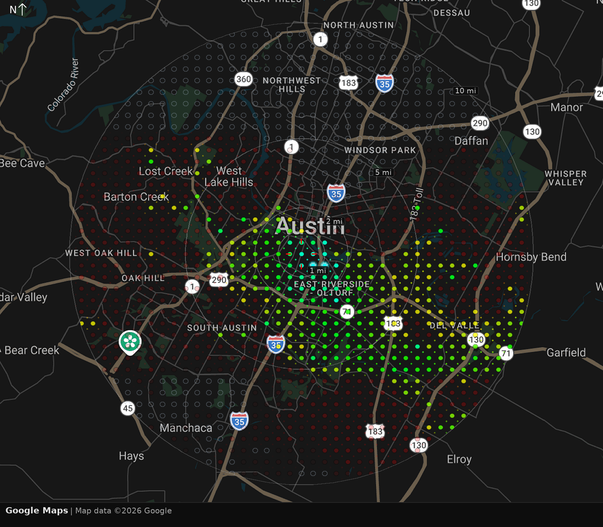
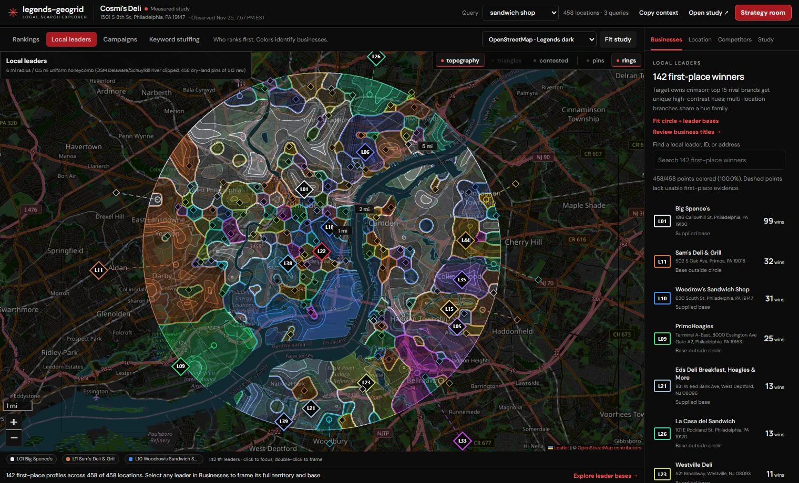
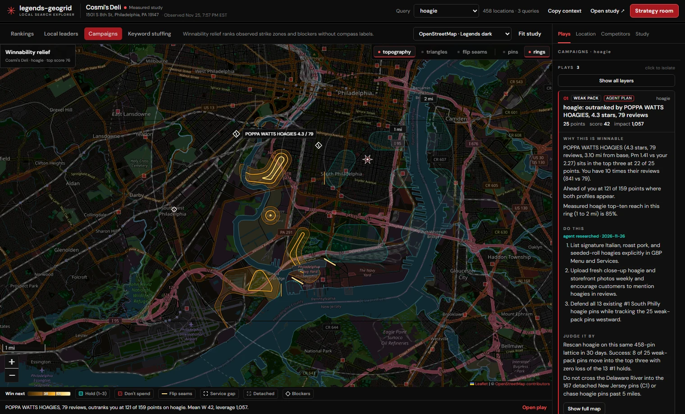
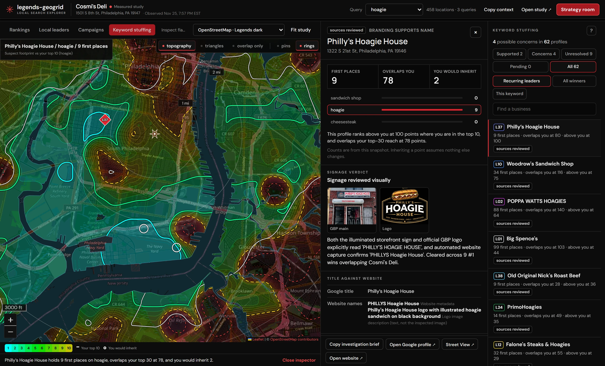
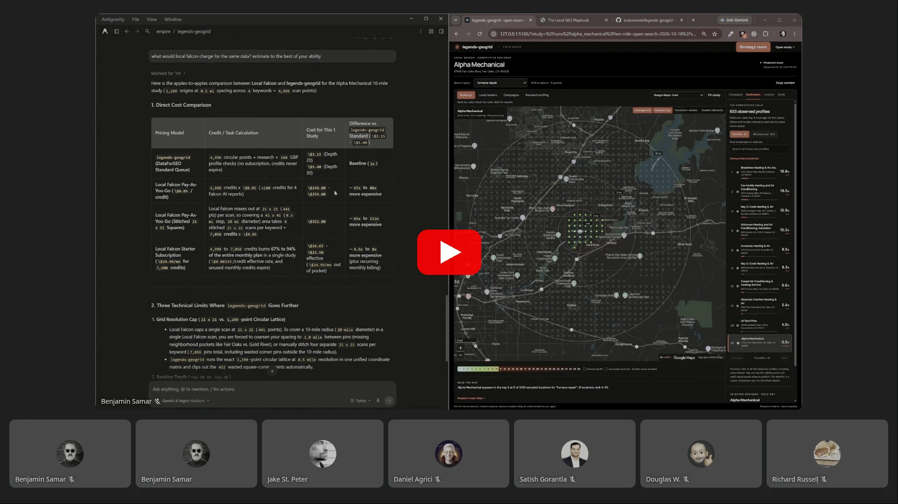
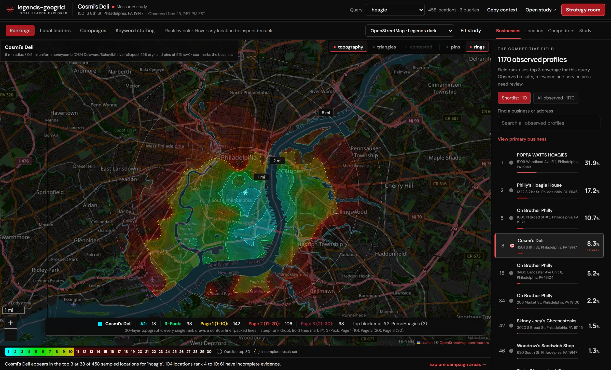
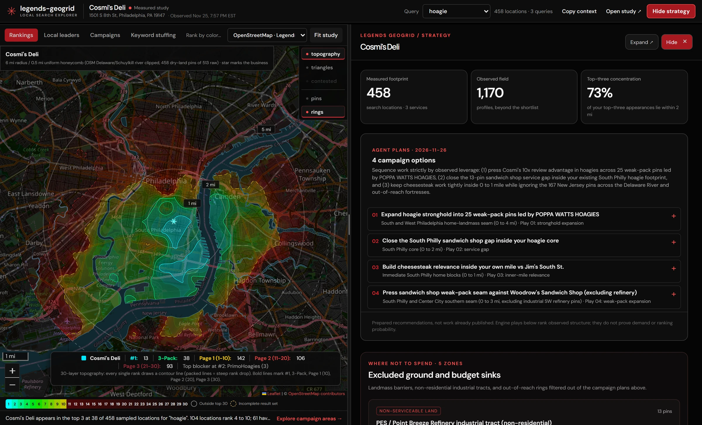

<a id="top"></a>

<p align="center"></p>

<p align="center">
  <a href="https://github.com/avalonreset/legends-geogrid/releases/latest"></a>
  <a href="https://github.com/avalonreset/legends-geogrid/actions/workflows/ci.yml"></a>
  <a href="LICENSE"></a>
</p>

# legends-geogrid: an open source local rank tracker that maps every search point instead of reporting one number

> *"The human is the controller. The agents do the operating. Stop being your computer's assistant."*

Home Slice Pizza ranks in the top three at 549 of 1,249 search points around Austin for one search, and at 21 of them for another. Clone this repo and that whole territory opens in your browser as a map you can flip between searches, with no keys and no spend.

`>_ agent handoff`

```text
Use cto-legends to install legends-geogrid, then open the example pizza map
so I can explore it without spending credits.
```

`>_ terminal quick start`

```sh
python -m pip install cto-legends
cto-legends install legends-geogrid            # dry run: prints the plan, writes nothing
cto-legends install legends-geogrid --apply    # installs through the router

git clone https://github.com/avalonreset/legends-geogrid.git   # or go straight to source
cd legends-geogrid
python tools/study.py --open                   # opens the free example map
```

Through the [cto-legends](https://github.com/avalonreset/cto-legends) router, the first install command is a dry run that prints the plan and writes nothing until you repeat it with `--apply`, and every paid search in this repo stays a cost estimate until you approve a dollar ceiling.

If you have ever had to explain why a business looks number one from its own front counter and vanishes two miles down the road, flip between the four searches and star the repo if the map changes your answer. Prefer to watch first? The [31-minute walkthrough](https://www.youtube.com/watch?v=0G7IF3yBxcM) runs the whole thing on screen.

---

## You do not have a rank. You have 1,249 of them

Stand at the front counter of a pizza shop on South Congress Avenue and search for pizza. Now drive two miles, run the same search, and a different list comes back.

Ask where a business ranks on Google Maps and the only accurate answer is two more questions. Ranked from where, and for which search?

Google answers a map search from the place the searcher is standing. Change two words in the query and the list shifts again.

The study bundled with this repo measured that around one real restaurant, using only public Google Maps results. Home Slice Pizza sits on South Congress in Austin, and 1,249 search points surround it on a 10-mile circle, half a mile apart, each one running the same four searches thirty results deep.

For "new york style pizza," Home Slice is in the top three at 549 of those points. For "pizza by the slice," it is 470. On "pizza restaurant," the count is 21. Under "pizza takeout," it is 6.

<p align="center">
  
  
</p>
<p align="center"><sub>Left: "pizza restaurant," top three at 21 of 1,249 points and top ten at 261. Right: "new york style pizza," top three at 549 and top ten at 1,023. One business, one collection, one set of search controls.</sub></p>

So which one is its rank? Any single number has to pick one of those maps and throw the others away.

It also throws away the two things an owner can act on, the place and the search. "We rank number four" tells nobody which neighborhoods to defend or which service page to write.

That is why this local rank tracker reports territory. Its footprint is a true circle clipped by distance from the business, because the corners of a square grid sit 41 percent farther out than its sides.

The searches are picked as carefully as the points. A study covers 3 to 5 researched themes with one query each, chosen from the business's website, its public Google profile and real search demand, never padded with synonyms.

## A Google Maps rank checker has to show its measurements

Maps are persuasive, and that makes a wrong one expensive. This repo keeps a written record of the day one of its own maps misled.

In one regional HVAC study, a recurring competitor disappeared along a perfectly straight line. Markets do not end in straight lines, so on October 18, 2026 a diagnostic went back to four existing points with four searches under three settings: 48 Standard requests, $0.0288.

At one of those points, with the "Search this area" restriction on, the competitor was missing from all four top-30 responses. Switch the restriction off and it came back at positions 5, 14, 8 and 10. That straight edge was a search setting masquerading as the market.

Three rules came out of those 48 requests, and the tool now enforces them.

- Open search is the default. The collector sends every point with the restriction off, and a restricted plan is rejected unless it states the displayed-area question it is asking.
- Missing is never drawn as losing. A point with incomplete evidence cannot appear on the map as "not ranked."
- Blanks stay blank. No rank is invented or interpolated to make the picture look finished, and the soft diamonds between markers are visual blending, never extra searches.

You can read those rules straight off the map. Every measured rank is a colored stop sign, cyan at first place through green to yellow at tenth, then red fading out toward thirtieth. A hollow outline means the business was absent from a complete top 30, and a dashed outline means the evidence is incomplete.

Suspicion is part of the agent's routine too. Before a study expands past an edge that looks too clean, it reruns paired points on both sides under different settings, and it keeps each setting as its own run so ranks are never patched together.

Collection for a study travels through [legends-dataforseo](https://github.com/avalonreset/legends-dataforseo), the sibling module that carries each request to DataForSEO's Standard Queue for Google Maps. The collector never switches to the pricier Live mode on its own; that takes your explicit request and an `--allow-live` flag.

Nothing gets spent by accident either. Every DataForSEO command prints an estimate and stops, and it runs only when it is handed both an execute flag and a dollar ceiling. If the estimate is above your ceiling, it aborts before a single network call.

## Hand this local SEO tool to your agent

None of this asks you to learn the commands. You say what you want in plain words, and your coding agent follows the recipe that ships in the repo.

Start with the free part. Say "open the example pizza map" and the agent builds one self-contained HTML file and opens it in your browser, with no server running, no port open and no account anywhere.

Then name a business. The agent reads its website, its public Google Business Profile and search demand, and comes back with a proposal: the search themes it would study, the lattice of points, and the cost ceiling.

Nothing is bought until you approve that proposal. After you do, the points are collected, every raw response is cached on your disk, and an interrupted run resumes without paying twice.

Finished studies open as interactive views. Local leaders shows who holds first place in each neighborhood, and Campaigns splits your own map into Defend, Advance and Build zones: ranks 1 to 3, ranks 4 to 10 and ranks 11 to 30. Points where the business is absent from the top 30 stay in a separate Outside top 30 band.

<p align="center">
  
  
</p>

One view checks names. When a first-place holder's title looks packed with keywords, the agent refreshes that exact profile, reads the brand on its website, pulls Street View from several angles and, with [legends-jev](https://github.com/avalonreset/legends-jev) installed, reads the lettering in the photos.

Two Austin profiles in the bundled study share one title, "Pedroso's Pizza- Slice Shop & Take Out," while the website brand is simply Pedroso's Pizza. On Airport Boulevard the logo badge really does carry the words SLICE SHOP and TAKE OUT, so that profile rates 2 of 5 across its 61 first-place wins. At Justin Lane no storefront sign has confirmed the extra words yet, so the same title rates 4 of 5 across 124.

<p align="center">
  
  
</p>

Same title, different evidence, different rating. A person still validates each reading, and the tool never files an edit or a complaint for you.

Costs are small enough to say out loud. All 4,996 searches in the bundled Austin study cost $2.9976 in data when they were collected, and a 5-mile study at the same spacing is 309 points and 1,236 searches, about $0.74.

Looking for an open source Local Falcon alternative? Here is the trade. There is no hosted dashboard and nothing runs on a schedule; in exchange you use your own data account, keep every raw response, and can read the method behind each pin.

Tracking over time is something you ask for. Bank a baseline, request a monitoring study when you want a fresh reading, and the study library links the two.

Installation runs through [cto-legends](https://github.com/avalonreset/cto-legends), the one router for this module and its siblings, so your agent finds the right tool from an ordinary request.

Watch it happen first if you prefer. The walkthrough below runs the Austin study on screen in 31 minutes.

<p align="center"><a href="https://www.youtube.com/watch?v=0G7IF3yBxcM"></a></p>

Run `python tools/study.py --open`, flip between the four searches on the pizza map, and star the repo if the map changed how you would answer "where do we rank."

---

<p align="center"><a href="#in-the-box">In the box</a> &middot; <a href="#views">Views</a> &middot; <a href="#cost">Cost</a> &middot; <a href="#ask-your-agent">Ask your agent</a> &middot; <a href="#boundaries">Boundaries</a> &middot; <a href="#faq">FAQ</a> &middot; <a href="#setup">Setup</a> &middot; <a href="#family">Family</a> &middot; <a href="#reference">Reference</a></p>

<a id="in-the-box"></a>

## In the box

Everything in this table ships with the code, collected on October 19, 2026 from public Google Maps results. Open it before you configure anything.

| Bundled Austin study | What you get |
| --- | --- |
| Business | Home Slice Pizza, 1415 S Congress Ave, Austin, TX (a public-data case study) |
| Footprint | 10-mile radius, 0.5-mile spacing, 1,249 search points |
| Searches | pizza restaurant, new york style pizza, pizza by the slice, pizza takeout |
| Observations | 4,996 point-and-search results, each to depth 30 |
| Field | 702 business profiles observed |
| Name check | 165 first-place profiles refreshed and screened, 79 recurring leaders individually rated 0 to 5 |
| Report | 19-page PDF plus a standalone HTML edition |
| Cost to open | No keys, no account, $0.00 |

Read the finished report at [`examples/starter-home-slice/report/report.pdf`](examples/starter-home-slice/report/report.pdf) and the study guide at [`examples/starter-home-slice/README.md`](examples/starter-home-slice/README.md).

<a id="views"></a>

## Views

| View | The question it answers |
| --- | --- |
| Local leaders | Who holds first place in each neighborhood, with adjacent winners kept in clearly different colors |
| Rankings | Where the business ranks at every point, 1 through 30, for the selected search |
| Keyword stuffing | Whether a first-place holder's profile name matches its website and its real sign |
| Campaigns | Which ground to Defend (ranks 1 to 3), Advance (ranks 4 to 10) or Build (ranks 11 to 30). Points absent from the top 30 sit in their own Outside top 30 band |
| Strategy Room | What the selected area, its rank context and the campaign plans say, in a side panel beside the map, with head-to-head comparisons between two profiles |
| Photo Lightbox | What the storefront photo, Street View capture or logo shows at full size |
| Strategy report | How the whole study reads on paper, as a PDF and HTML report with maps and scorecards |

<p align="center">
  
  
</p>

<a id="cost"></a>

## Embeddable viewer

`pnpm build:viewer` also writes a standalone report viewer to `dist-viewer/`. It is one script, one stylesheet and one worker file, mounted with `GeoGridViewer.mount(element, model, options)`, and it works under a strict Content Security Policy. It renders the rank pin map, scores, zone statistics, the competitor table and the change since the previous scan from a small `geogrid-viewer/v1` model, and it can also open a full `geogrid-companion/v1` study. With `perPointListings` on, a full study shows every captured ranking: the top 20 at each location with a show all control, the actual rank beyond 20, and a competitor panel across the grid. See [`docs/VIEWER.md`](docs/VIEWER.md), [`docs/viewer-model.md`](docs/viewer-model.md) and the fixture `examples/viewer-companion-depth100-fixture.json`.

## Cost

Fresh studies bill to your own DataForSEO account at that provider's task rates. This tool adds nothing on top.

| Study | Search tasks | Standard Queue data cost |
| --- | --- | --- |
| Bundled Austin study | 4,996, already collected | $0.00 to open |
| 5-mile radius, 0.5-mile spacing | 309 points x 4 searches = 1,236 | about $0.74 |
| 10-mile radius, 0.5-mile spacing | 1,249 points x 4 searches = 4,996 | about $3.00 |
| Name check on 165 first-place profiles | 165 profile refreshes | about $0.25 |

Rates in the code: $0.0006 per Standard Queue Maps search at depth 30, $0.0012 for Priority, $0.0020 for Live, and $0.0015 per profile refresh. Check the preflight estimate and the provider's current pricing before you approve a run.

Both of these flags are required on every DataForSEO command.

- `--execute` authorizes the live submission.
- `--confirm-cost-usd <ceiling>` aborts the run before any network call if the estimate is higher than your ceiling.

Your ceiling is a preflight check on this machine. It is not a billing limit enforced by the provider.

<a id="ask-your-agent"></a>

## Ask your agent

| Say this | What your agent does |
| --- | --- |
| "Open the example pizza map so I can explore it without spending credits." | Runs `python tools/study.py --open`, builds a static Companion file and opens it. No keys, no calls. |
| "Study `<business name>` on Google Maps." | Researches the website, public profile and search demand, proposes 3 to 5 search themes, shows the lattice and cost ceiling, then waits for your approval. |
| "Check why a competitor disappears along a straight line on the east edge of our map." | Reruns paired points on both sides of the edge with the search restriction on and off, saves that as a separate diagnostic run, and reports who comes back. |
| "Check the first-place holders in this study for keyword stuffing and read their signs." | Refreshes exact profiles through the Standard Queue, captures website branding and multi-angle Street View, and runs the optional `legends-jev` sign check. |
| "Expand this study out to 10 miles." | Plans the larger circle at the same spacing with `radius_sampling.py`, collects the new points on the Standard Queue within the budget you approve, composes one complete 10-mile study from the saved scans, and banks it as an expansion of the original. |
| "Render the report." | Builds the PDF and HTML strategy report and runs page-by-page layout checks on the result. |

Full agent instructions live in [`AGENTS.md`](AGENTS.md) and [`docs/STUDY-RECIPE.md`](docs/STUDY-RECIPE.md).

<a id="boundaries"></a>

## Boundaries

- Hosted dashboards, white-label portals and scheduled tracking are out of scope. You run it, and nothing runs for you in the background.
- API keys are never bundled. Fresh scans use your own DataForSEO account.
- Profile edits and competitor complaints are never submitted to Google for you.
- Rank share is never converted into revenue, call volume or conversion claims.
- "Not returned" means absent from this top-30 Maps response under the recorded settings. It is not proof of invisibility in every Google experience.
- Results describe Google Maps searches at a recorded zoom and depth. They are not presented as personalized, organic-web or local-pack rankings.
- Turning the "Search this area" restriction off widens what comes back. It does not guarantee that every business appears.
- Name check ratings are research findings for a person to validate, never a violation verdict.

<a id="faq"></a>

## FAQ

<details><summary><strong>How does a local rank tracker measure a whole territory?</strong></summary>

<br>

Position decides the answer on Google Maps, so one check from a city center describes one spot. This tool searches from hundreds of points on a circle around the business, 309 at five miles and 1,249 at ten with half-mile spacing, and records the top 30 at each.

</details>

<details><summary><strong>Is this an open source Local Falcon alternative?</strong></summary>

<br>

Yes, if you would rather run the study yourself. Local Falcon is a hosted product, while this is MIT-licensed code that runs on your machine with your own DataForSEO account and leaves every raw response on your disk. It is independent software, not affiliated with or endorsed by Local Falcon.

</details>

<details><summary><strong>Can I try this Google Maps rank checker without API keys?</strong></summary>

<br>

Keys are optional for the first look. The full Austin study and its report ship in the repo, and `python tools/study.py --open` opens them with no account and no spend.

</details>

<details><summary><strong>Which searches does this local SEO tool study?</strong></summary>

<br>

Usually 3 to 5 researched themes, with one representative query per theme. Fewer needs a stated reason, and synonyms are never added to pad the count.

</details>

<details><summary><strong>Does it track rankings on a schedule?</strong></summary>

<br>

No. Tracking over time means banking a baseline study and running a monitoring study when you want a new reading, linked in the study library with `--relationship monitoring`.

</details>

<details><summary><strong>What does the keyword stuffing check conclude?</strong></summary>

<br>

Each individually reviewed profile gets a 0 to 5 concern rating tied to its exact current title, with sources, timestamps and counterevidence kept. It is a research finding, and missing evidence stays unscored.

</details>

<details><summary><strong>What are the diamonds between the markers?</strong></summary>

<br>

Visual blending only. A diamond mixes the colors of the four measured points around it and is never an extra search or a predicted rank.

</details>

<a id="setup"></a>

## Setup

Python 3.11 or newer is all the free map needs. Fresh scans, report rendering and street basemaps each add one requirements file, and one doctor command checks all of it offline.

```sh
python -m pip install -r requirements-dataforseo.txt -r requirements-report.txt -r requirements-basemaps.txt
python -m playwright install chromium          # on a bare Linux host: --with-deps chromium
python tools/geogrid_doctor.py --dataforseo --jev --reports --basemaps --check-playwright --json
```

The doctor is an offline readiness check. It makes no paid calls and reports whether credentials are configured without printing them. Node.js 22 or newer is needed only for UI source development with `pnpm install --frozen-lockfile` and `pnpm dev`.

Tested pairing: `legends-geogrid` v0.2.7 with `legends-dataforseo` v0.1.11 or newer and the optional `legends-jev` v0.2.3 or newer.

<a id="family"></a>

## Family

| Module | Its job in a study |
| --- | --- |
| [cto-legends](https://github.com/avalonreset/cto-legends) | The router. Previews and installs this module, then loads its recipe with `cto-legends handoff legends-geogrid`. |
| [legends-dataforseo](https://github.com/avalonreset/legends-dataforseo) | Carries Maps searches, search demand checks and profile refreshes to DataForSEO. |
| [legends-jev](https://github.com/avalonreset/legends-jev) | Optional. Reads storefront signs in profile photos and Street View captures for the name check. |

`cto-legends` is the only registered agent skill; this repo vendors a pinned copy at `skills/cto-legends/SKILL.md`. Do not register this module as its own skill.

<a id="reference"></a>

## Reference

<details><summary><strong>Full CLI and command reference (click to expand)</strong></summary>

<br>

Commands marked "both gates" spend nothing unless `--execute` and `--confirm-cost-usd <ceiling>` are both passed. Every `tools/study.py` subcommand also accepts `--vault-dir`.

| Command | What it does | Spend |
| --- | --- | --- |
| `python tools/study.py --open` | Builds and opens the static Companion. Options: `--study`, `--research`, `--name-review`, `--output`, `--no-browser`, `--pdf`. | None |
| `python tools/study.py website --url <url> --output <file>` | Fetches public business website context over HTTPS. | None |
| `python tools/study.py lookup --query <query> --output-dir <dir>` | Looks up the business identity (CID and place ID) through the free monthly allowance of the Google Places API (New). If the free lookup is unavailable it reports the fallback and stops. Options: `--near`, `--tier`. | No DataForSEO spend |
| `python tools/study.py research --request <json> --output-dir <dir>` | Runs search demand research and writes a research ledger. `--allow-live` is an explicit opt-in. | Both gates |
| `python tools/study.py query-review --plan <plan.json>` | Audits search themes, categories and observation age before collection. | None |
| `python tools/study.py validate --plan <plan.json>` | Validates the study contract. Writes nothing. | None |
| `python tools/study.py proposal --plan <plan.json> --output-dir <dir>` | Renders the pre-collection proposal with points, searches and cost ceiling. | None |
| `python tools/study.py run --plan <plan.json> --output-dir <dir>` | Validates, then collects and banks checkpoints. | Both gates |
| `python tools/study.py assemble --run-dir <dir> --output-config <file>` | Assembles `report-config.json` from a run directory. | None |
| `python tools/study.py battlefield --run-dir <dir> --output-dir <dir>` | Writes the offline territory model, console and report. | None |
| `python tools/study.py enhance --run-dir <dir> --output-dir <dir>` | Adds detail inside an existing square grid without changing its extent (5 x 5 becomes 9 x 9). Reuses fresh banked observations and collects only the added points, through Maps Live. It does not push the radius outward. | Both gates |
| `python tools/study.py bank --plan <plan.json>` | Banks artifacts into the study library with SHA-256 hashes. `--relationship baseline`, `expansion` or `monitoring`. | None |
| `python tools/study.py library-init` | Initializes the study library. | None |
| `python tools/competitive_sampling.py --battlefield <model>` | Plans an irregular exploratory footprint around the business and its rivals: citadels (the business locations), corridor midpoints between them, 3x3 micro-grids and compass sentinels. It does not define the main grid. | None |
| `python tools/competitive_collect.py --plan <plan.json> --output-dir <dir>` | Collects Google Maps results on the Standard Queue. `--allow-live` is an explicit opt-in. | Both gates |
| `python tools/competitive_export.py --run-dir <dir> --output <file> --compact` | Exports a `geogrid-companion/v1` dataset for the Companion. | None |
| `python tools/business_name_review.py plan` | Lists first-place profiles and estimates the refresh cost. | None |
| `python tools/business_name_review.py submit` | Submits Standard Queue profile refreshes. | Both gates |
| `python tools/business_name_review.py retrieve`, `websites`, `photos`, `export`, `attach` | Retrieves results, captures branding and photos, exports the review and attaches it to the study. `photos --jev` adds the sign check. | No DataForSEO spend |
| `python tools/strategy_report.py --config <report-config.json> --output-dir <dir>` | Renders the PDF and HTML report with layout QA. `--basemap`, `--proof`, `--require-pdf-qa`. | No DataForSEO spend |
| `python tools/geogrid_doctor.py` | Offline readiness check. `--reports`, `--dataforseo`, `--jev`, `--basemaps`, `--check-playwright`, `--json`. | None |
| `python tools/radius_sampling.py` | Calculates a circular lattice and its cost estimate, for a new study or a radius expansion. | None |
| `python tools/radius_compose.py` | Composes one complete radius study from saved scans, such as an inner study plus a newly collected outer ring. Makes no paid requests. | None |
| `python tools/sampling_review.py` | Reviews sampling adequacy and boundary cliffs after measurement. | None |
| `python tools/verify_pins.py` | Verifies report pins against the raw results. | None |
| `python tools/pollution_gate.py` | Probes spread points to reject a polluted keyword. This one calls Live directly. | Both gates |
| `pnpm dev`, `pnpm build`, `pnpm test`, `pnpm check` | UI development server, production build, Python tests and the full local check suite. | None |

Raw single-grid and batch runners (`tools/local_heatmap_poc.py`, `tools/bulk_geogrid_runner.py`, `tools/adaptive_geogrid.py`) also require an explicit `--diagnostic` flag before they will execute.

Basemap imagery from Google is optional in reports and needs your own key plus `--allow-google-maps-charge`. Street maps default to OpenFreeMap with no key.

</details>

<details><summary><strong>Disk layout, verification and license (click to expand)</strong></summary>

<br>

Where things land:

- `runs/` and `bulk-runs/` hold fresh run folders and are ignored by Git.
- Static Companion builds from `python tools/study.py --open` land at `runs/starter-home-slice/companion.html`.
- Report directories hold `report.pdf`, `report.html`, `report-model.json`, `report-qa.json`, `sampling-review.json`, `leaders-map.png` and one `map-NNN.png` per search.
- `~/.legends-geogrid/vault/GeoGrid` is the study library, movable with `--vault-dir` or `GEOGRID_VAULT_DIR`. It keeps a catalog, one folder per business and a hashed manifest per study revision.

Verification:

- `pnpm check` runs the dependency audit, build, Python and viewer tests, the report doctor, a sample dry run and the report smoke test.
- `report-qa.json` is the page-by-page layout receipt for every rendered report.
- Pin checks run through `python tools/verify_pins.py` against the raw results.

Credentials and guardrails:

- DataForSEO credentials are read from the environment: `DATAFORSEO_LOGIN` or `DATAFORSEO_USERNAME`, plus `DATAFORSEO_PASSWORD`. `tools/pollution_gate.py` reads only `DATAFORSEO_LOGIN`, so set that name if you run it. The optional sign check reads `TYPESAFE_API_KEY` or an explicit `--typesafe-api-key-file`.
- Secrets are never printed, logged or embedded in a report.
- Symlink paths are refused on file inputs, key files and output paths.
- Agent instructions require ordinary visible processes, with no hidden consoles and no hidden background dev servers.

Only public Maps observations, public profile metadata and public website branding excerpts are in the bundled starter study. It holds no credentials and no account identifiers.

License and attribution:

- MIT licensed. See [LICENSE](LICENSE), [CONTRIBUTING.md](CONTRIBUTING.md) and [SECURITY.md](SECURITY.md).
- [Leaflet](https://github.com/Leaflet/Leaflet) provides the interactive map library, and [OpenStreetMap](https://www.openstreetmap.org/copyright) contributors provide the default map data.
- Optional Google Maps and Google Business Profile APIs for new scans come from [DataForSEO](https://dataforseo.com/apis/serp-api/google-maps-api).
- [Vite](https://github.com/vitejs/vite) and [PostCSS](https://github.com/postcss/postcss) are the MIT-licensed build tools; production builds generate `dist/third-party-licenses.md`.
- [Claude SEO](https://github.com/AgriciDaniel/claude-seo) by Daniel Agrici contributes the vendored reference skills under `third_party/claude-seo/`.
- [ReportLab](https://www.reportlab.com/) and [Pillow](https://python-pillow.org/) power local PDF generation and image processing.
- Complete detail is in [docs/PROVENANCE.md](docs/PROVENANCE.md) and [THIRD_PARTY_NOTICES.md](THIRD_PARTY_NOTICES.md).

Independence note: `legends-geogrid` is not affiliated with or endorsed by DataForSEO, Google, OpenStreetMap, Leaflet, Local Falcon or BrightLocal.

</details>

<details><summary><strong>Documentation map (click to expand)</strong></summary>

<br>

- [`AGENTS.md`](AGENTS.md): agent instructions, the free demo launch and the spend-gate rules.
- [`docs/STUDY-RECIPE.md`](docs/STUDY-RECIPE.md) and [`docs/START_A_STUDY.md`](docs/START_A_STUDY.md): discovery, search selection, collection and export from end to end.
- [`docs/QUERY_SELECTION_POLICY.md`](docs/QUERY_SELECTION_POLICY.md) and [`docs/STUDY_CONTRACT.md`](docs/STUDY_CONTRACT.md): how the 3 to 5 search themes are chosen and validated.
- [`docs/SEARCH_WINDOW_POLICY.md`](docs/SEARCH_WINDOW_POLICY.md) and [`docs/COMPETITIVE_SAMPLING.md`](docs/COMPETITIVE_SAMPLING.md): the straight-edge diagnostic, open search, circular sampling and radius expansion.
- [`docs/COMPANION.md`](docs/COMPANION.md): every map view, color rule and marker state.
- [`docs/BATTLEFIELD_INTELLIGENCE.md`](docs/BATTLEFIELD_INTELLIGENCE.md): the Strategy Room, territory campaigns and head-to-head comparisons.
- [`docs/BUSINESS_NAME_REVIEW.md`](docs/BUSINESS_NAME_REVIEW.md): the name check rubric and its evidence limits.
- [`docs/ENHANCE.md`](docs/ENHANCE.md) and [`docs/STUDY_LIBRARY.md`](docs/STUDY_LIBRARY.md): adding detail inside an existing grid at the same extent, and how baselines, expansions and monitoring studies are linked in the study library.
- [`docs/BASEMAPS.md`](docs/BASEMAPS.md) and [`docs/TECHNICAL_NOTES.md`](docs/TECHNICAL_NOTES.md): street maps, optional Google tiles and cache verification.

</details>

---

Installed and routed by [cto-legends](https://github.com/avalonreset/cto-legends). The module page and the rest of the family are at [cto-legends.com](https://cto-legends.com/modules/legends-geogrid).

[Back to top](#top)
