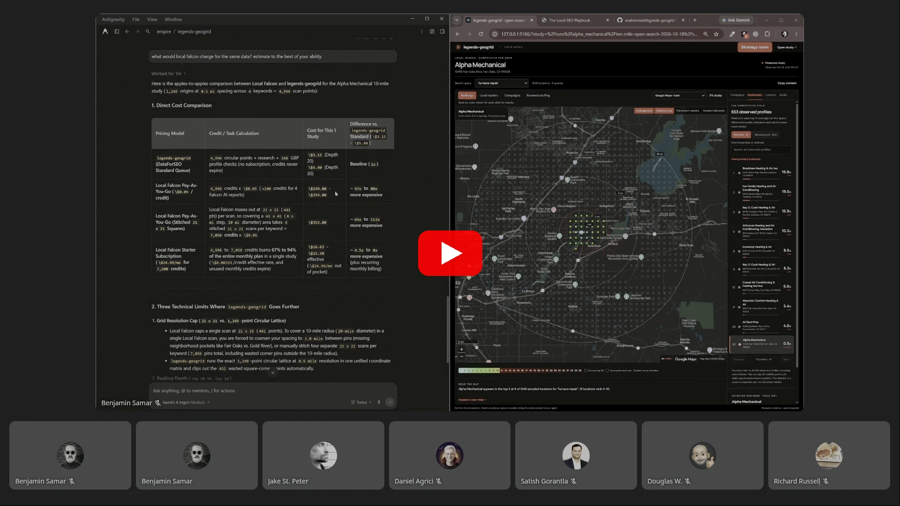
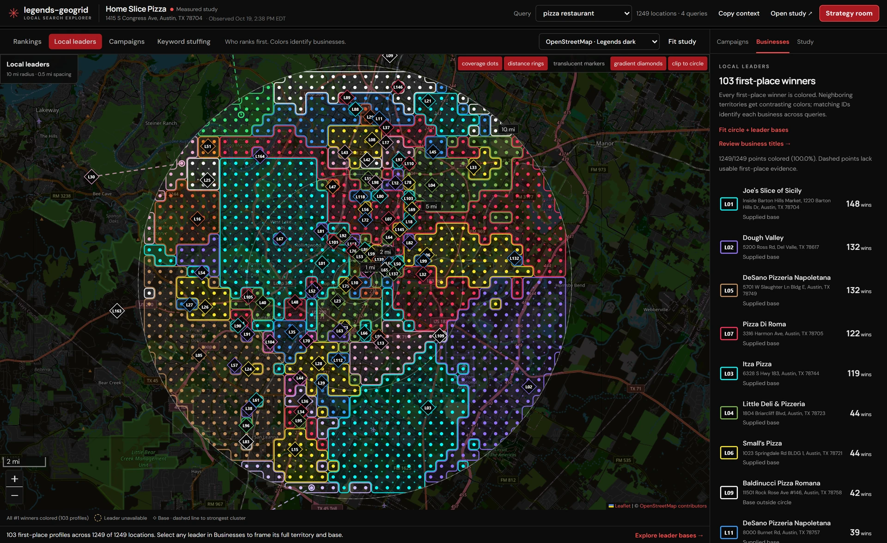
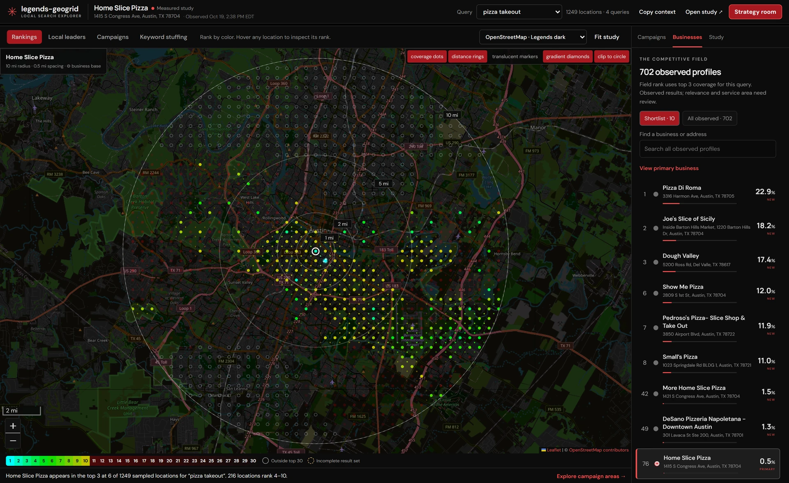
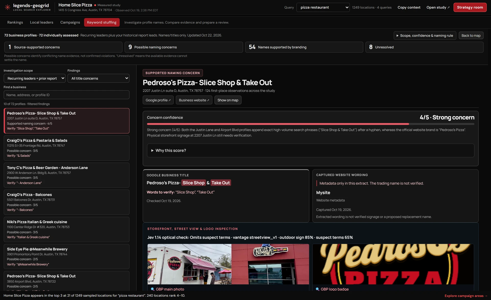
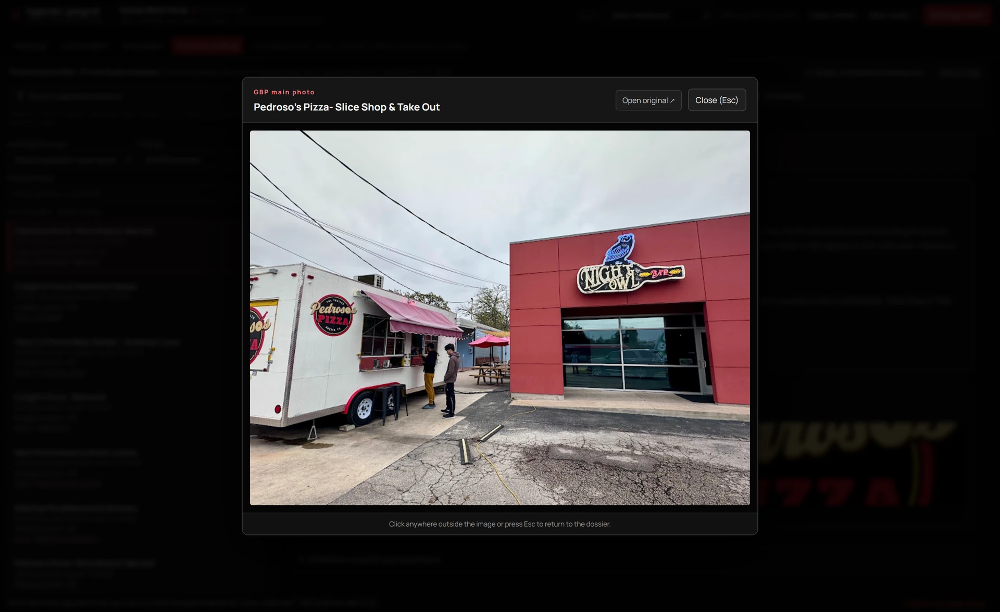
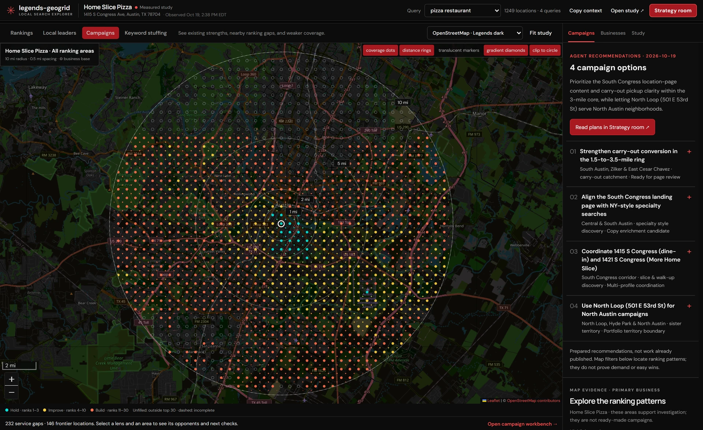
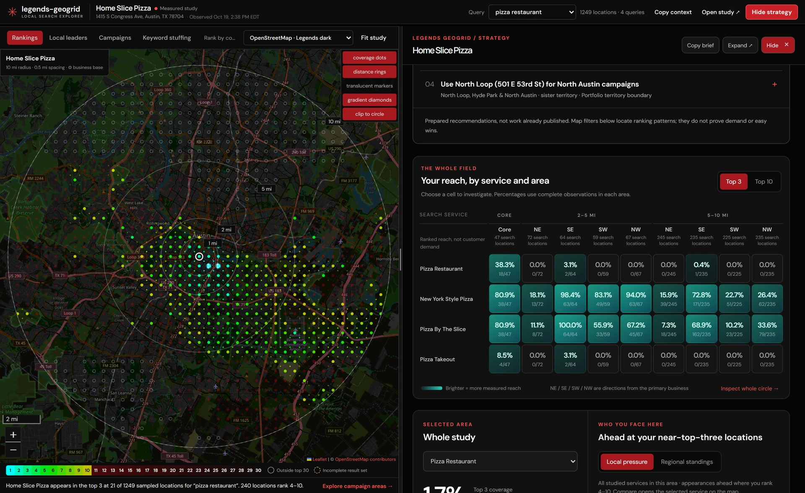

<a name="banner"></a>
<a name="legends-geogrid"></a>

# 

[](https://github.com/avalonreset/legends-geogrid/releases/latest)
[](https://github.com/avalonreset/legends-geogrid/actions/workflows/ci.yml)
[](LICENSE)

**legends-geogrid is an agent-first, open-source google maps rank checker and local SEO battlefield explorer.**

Instead of paying a monthly rank-tracking subscription to stare at square grids of red and green dots by yourself, you work with your coding agent. Ask your agent to open the bundled 10-mile Austin pizza case study for `$0`, or tell it to study your own business on Google Maps. Your agent researches the market, samples an unbiased circular lattice through [legends-dataforseo](https://github.com/avalonreset/legends-dataforseo) at raw API cost, checks competitor storefront signage with [legends-jev](https://github.com/avalonreset/legends-jev) optical recognition, and opens the full-bleed **Competitive Map Companion** alongside an **18-page Letter PDF strategy report**.

**Quick links:** [Visual tour](#visual-tour) · [Talk to your agent](#talk-to-your-agent) · [Zero-credit starter study](examples/starter-home-slice/README.md) · [18-page sample PDF](examples/starter-home-slice/report/report.pdf) · [Data-cost economics](#data-cost-economics) · [Documentation](#documentation-for-agents-and-builders)

---

## Agent setup (via `cto-legends`)

Part of the [cto-legends](https://github.com/avalonreset/cto-legends) ecosystem. `cto-legends` is the only registered skill; this repo vendors a pinned copy at `skills/cto-legends/SKILL.md`.

Install with `cto-legends install legends-geogrid`, then follow the module recipe the router loads. Do not register this module as its own skill.

<p align="left">
  <a href="https://www.youtube.com/watch?v=0G7IF3yBxcM">
    
  </a>
</p>
<p align="left">
  <a href="https://www.youtube.com/watch?v=0G7IF3yBxcM"><strong>▶ Watch the full 31-minute walkthrough on YouTube:</strong> <em>open source + up to 80x cheaper than local falcon for local seo</em></a>
</p>

---

## Visual tour

Every install ships with a complete, real-world **10-mile, 0.5-mile spacing (`1,249`-origin, 4-query, top-30)** study of **Home Slice Pizza** in Austin, Texas (`702` observed competitors and `165` optically verified business profiles). You can explore every view below right now in your browser without API keys or spend.

### 1. Local leaders & neighbor-colored territories

See who actually wins `#1` across every neighborhood on a true circular radius. Neighboring territories are automatically assigned contrasting colors with stable study-wide `L`-number badges (`L01` through `L165`) and dashed connectors to competitor bases outside the circle.

### 2. Circular-lattice rankings & gradient territories

Inspect top-30 organic Google Maps rankings across studied search themes (`pizza restaurant`, `pizza takeout`, `pizza by the slice`, `new york style pizza`) with equal-sided stop-sign pins, four-corner continuous gradient diamonds, rank-1 cyan shimmer, and `clip to circle` boundary clipping.

### 3. Keyword stuffing & Jev 1.14 optical signage verification

Audit recurring `#1` competitors for Google Business Profile name stuffing. Your agent refreshes exact Google CIDs, extracts website branding, captures multi-vantage Street View (`v0`, `v1`, `v2`), and runs **Jev 1.14 optical signage checks** across storefront photos and logo badges to score concern confidence (`0-5` `title-evidence-v1`) with counterevidence kept in plain sight.

### 4. In-app photo Lightbox inspection

Click any GBP exterior photo, Street View capture, or logo badge inside the dossier to inspect full-resolution physical signage in an in-app modal without losing your place. Click anywhere outside the photo or press `Esc` to return.

### 5. Territory campaigns & foothold planning

Separate the map into defended footholds (`ranks 1-3`), advance zones (`ranks 4-10`), and build zones (`ranks 11-30`), paired directly with study-bound `campaign-research.json` action briefs.

### 6. Split-screen Strategy Room & head-to-head matchups

Dock the resizable **Strategy Room** beside the live map to compare top-3 and top-10 reach across every studied service and directional ring (`Core`, `2-5 mi`, `5-10 mi`), inspect regional leaderboards, or launch direct two-profile **Head-to-head** map overlays.

---

## Talk to your agent

`legends-geogrid` is built for conversation. You do not need to memorize dozens of CLI flags; tell your coding agent what outcome you want, and the agent follows [`AGENTS.md`](AGENTS.md) and [`docs/STUDY-RECIPE.md`](docs/STUDY-RECIPE.md).

| What you tell your agent | What happens under the hood |
| --- | --- |
| *"Open the example pizza map so I can explore it without spending credits."* | Runs `python tools/study.py --open` (or `pnpm dev`) to launch the pre-loaded 10-mile Austin starter study in your browser, plus [`examples/starter-home-slice/report/report.pdf`](examples/starter-home-slice/report/report.pdf). Zero credentials or API calls required. |
| *"Study `<Business Name>` on Google Maps."* | Researches the business website, public Google Business Profile, and search demand; recommends [3-5 distinct search themes](docs/QUERY_SELECTION_POLICY.md); previews the circular lattice and DataForSEO cost ceiling; and waits for your approval before collecting. |
| *"Audit the top competitors in this study for keyword stuffing and check their storefront signs."* | Runs Standard-queue exact-CID profile refreshes, website branding captures, multi-vantage Street View (`v0`, `v1`, `v2`), and `legends-jev` 1.14 optical signage verification (`business_name_review.py photos --jev`), then attaches the dossier to your study. |
| *"Enhance this study out to 10 miles."* | Reuses every inner-radius observation already banked on disk (`tools/radius_compose.py`), collects only the outer ring within your approved budget, and generates a new companion dataset and Letter PDF/HTML report edition. |

### Want to launch the zero-credit browser demo manually?

If you just cloned the repo and want to pop open the Austin starter study yourself (Node.js 20.19+ or 22.12+ and `pnpm` 10+):

```powershell
git clone https://github.com/avalonreset/legends-geogrid.git
cd legends-geogrid
pnpm install --frozen-lockfile
pnpm dev
```

Or open the pre-built 18-page strategy report directly at [`examples/starter-home-slice/report/report.pdf`](examples/starter-home-slice/report/report.pdf).

---

## Data-cost economics

If you are evaluating an open-source Local Falcon alternative, the core advantage is **raw data-cost ownership**: you run studies locally with your own [DataForSEO](https://dataforseo.com/apis/serp-api/google-maps-api) account and keep every raw JSON response, companion dataset, and PDF report on your own machine.

| Study size / workflow | Sampled origins (`4` queries, `depth=30`) | Total SERP tasks | Estimated Standard Queue data cost |
| --- | --- | --- | --- |
| **Bundled Austin starter study** (`Home Slice Pizza`) | `1,249` origins (`10 mi` radius, `0.5 mi` spacing) | `4,996` (pre-collected) | **`$0.00`** (included offline) |
| **5-mile neighborhood study** (`0.5 mi` spacing) | `317` origins x `4` queries | `1,268` tasks | **`~$0.76`** |
| **10-mile metro battlefield study** (`0.5 mi` spacing) | `1,249` origins x `4` queries | `4,996` tasks | **`~$3.00`** |
| **Exact-CID GBP title & signage audit** (`165` profiles) | `165` `my_business_info` Standard tasks + optional `legends-jev` 1.14 optical pass | `165` tasks | **`~$0.10 - $0.25`** |

*Note: Cost figures above use DataForSEO's modeled Standard Queue baseline (`$0.0006` per task at `depth=20`, `$0.0009` at `depth=30`). Always review the generated preflight estimate and current provider pricing before approving live execution.*

### Built-in spend safety

Every paid runner estimates cost offline by default and refuses to make network calls unless **both** spend gates are explicitly supplied:
- `--execute` (authorizes live provider submission)
- `--confirm-cost-usd <ceiling>` (aborts preflight if the estimated cost exceeds your ceiling)

---

## Environment readiness (`geogrid_doctor.py`)

When you or your agent set up fresh scans, PDF report rendering, or optical signage verification, one readiness command checks the entire local toolchain without making paid API calls:

```sh
python -m pip install -r requirements-dataforseo.txt -r requirements-report.txt -r requirements-basemaps.txt
python -m playwright install --with-deps chromium
python tools/geogrid_doctor.py --dataforseo --jev --reports --basemaps
```

**Tested ecosystem pairing:** `legends-geogrid` `v0.2.1` with [`legends-dataforseo`](https://github.com/avalonreset/legends-dataforseo) `v0.1.5` and optional [`legends-jev`](https://github.com/avalonreset/legends-jev) `v0.2.0` (`Jev 1.14` optical recognition and storefront signage grounding).

---

## Documentation for agents and builders

All deep-dive CLI workflows, sampling contracts, and report specifications live in [`docs/`](docs/):

- **Start here & agent workflows**:
  - [`AGENTS.md`](AGENTS.md) : canonical agent instructions, zero-credit demo launch, and spend-gate rules.
  - [`docs/STUDY-RECIPE.md`](docs/STUDY-RECIPE.md) & [`docs/START_A_STUDY.md`](docs/START_A_STUDY.md) : end-to-end discovery, query selection, circular-lattice collection, and companion export.
  - [`docs/ENHANCE.md`](docs/ENHANCE.md) & [`docs/STUDY_LIBRARY.md`](docs/STUDY_LIBRARY.md) : incremental radius expansion and automatic local study banking.
- **Companion, intelligence & optical signage review**:
  - [`docs/COMPANION.md`](docs/COMPANION.md) : interactive map lenses, neighbor-aware leader coloring, and `Open study` attachment loading.
  - [`docs/BUSINESS_NAME_REVIEW.md`](docs/BUSINESS_NAME_REVIEW.md) : GBP keyword-stuffing rubric (`title-evidence-v1`), multi-vantage Street View Search Quest (`v0`, `v1`, `v2`), and `legends-jev` 1.14 optical signage verification.
  - [`docs/BATTLEFIELD_INTELLIGENCE.md`](docs/BATTLEFIELD_INTELLIGENCE.md) : Strategy Room reach matrix, territory campaigns, and head-to-head matchups.
- **Measurement discipline & reports**:
  - [`docs/COMPETITIVE_SAMPLING.md`](docs/COMPETITIVE_SAMPLING.md) & [`docs/SEARCH_WINDOW_POLICY.md`](docs/SEARCH_WINDOW_POLICY.md) : unbiased circular-lattice geometry (`search_this_area=false`) and nested radius composition.
  - [`docs/QUERY_SELECTION_POLICY.md`](docs/QUERY_SELECTION_POLICY.md) & [`docs/STUDY_CONTRACT.md`](docs/STUDY_CONTRACT.md) : evidence-backed 3-5 query theme selection.
  - [`docs/BASEMAPS.md`](docs/BASEMAPS.md) & [`docs/TECHNICAL_NOTES.md`](docs/TECHNICAL_NOTES.md) : OpenFreeMap/OSM street basemaps, optional Google Map Tiles setup, point-state denominators, and SHA-256 cache verification.
  - [`examples/starter-home-slice/README.md`](examples/starter-home-slice/README.md) : complete guide to the bundled 10-mile Austin starter dataset and 18-page PDF report.

---

## Data, privacy, and attribution

Fresh run folders (`runs/`, `bulk-runs/`) are ignored by Git by default. The bundled Home Slice Pizza starter case study (`src/data/home-slice-*.json` and `examples/starter-home-slice/`) was collected on October 19, 2026 (`1,249` origins across a `10-mile` radius at `0.5-mile` spacing, `4` queries, `depth=30`, `search_this_area=false`) and contains only public Maps observations, public GBP metadata, and public website branding excerpts. It contains no credentials, account identifiers, or private client data.

### Attribution and provenance

- [Leaflet](https://github.com/Leaflet/Leaflet) provides the interactive map library under the BSD 2-Clause License.
- [OpenStreetMap](https://www.openstreetmap.org/copyright) contributors ([GitHub](https://github.com/openstreetmap)) provide the default map data under the ODbL.
- [DataForSEO](https://dataforseo.com/apis/serp-api/google-maps-api) ([GitHub](https://github.com/dataforseo)) provides the optional Google Maps and Google Business Profile APIs used for fresh scans.
- [Vite](https://github.com/vitejs/vite) and [PostCSS](https://github.com/postcss/postcss) are MIT-licensed build tools; production builds generate `dist/third-party-licenses.md`.
- [Claude SEO](https://github.com/AgriciDaniel/claude-seo) by Daniel Agrici ([agricidaniel.com](https://agricidaniel.com)) contributes the vendored `seo-dataforseo` and `seo-maps` reference skills under `third_party/claude-seo/` (MIT License).
- [ReportLab](https://www.reportlab.com/) and [Pillow](https://python-pillow.org/) power local vector PDF generation and image processing (`requirements-report.txt`).
- Product research compared public workflow and pricing information from [Local Falcon](https://www.localfalcon.com/) ([GitHub](https://github.com/local-falcon)), [Search Atlas](https://searchatlas.com/local-seo-software/) ([GitHub](https://github.com/search-atlas-group)), [LeadSnap](https://leadsnap.com/features/local-citations/), and [BrightLocal](https://www.brightlocal.com/citation-builder/) ([GitHub](https://github.com/BrightLocal)) as market references only; see [Provenance](docs/PROVENANCE.md) and [Third-party notices](THIRD_PARTY_NOTICES.md).

### Contributing, security, and license

See [CONTRIBUTING.md](CONTRIBUTING.md) and [SECURITY.md](SECURITY.md). `legends-geogrid` is MIT licensed ([LICENSE](LICENSE)) and is independent software not affiliated with or endorsed by DataForSEO, Google, OpenStreetMap, Leaflet, Local Falcon, Search Atlas, LeadSnap, or BrightLocal.

---

<p align="left">
  <a href="https://www.youtube.com/shorts/4RYY_gh6b70">
    
  </a>
</p>
<p align="left">
  <a href="https://www.youtube.com/shorts/4RYY_gh6b70"><em>why have we never met before?</em></a>
</p>
